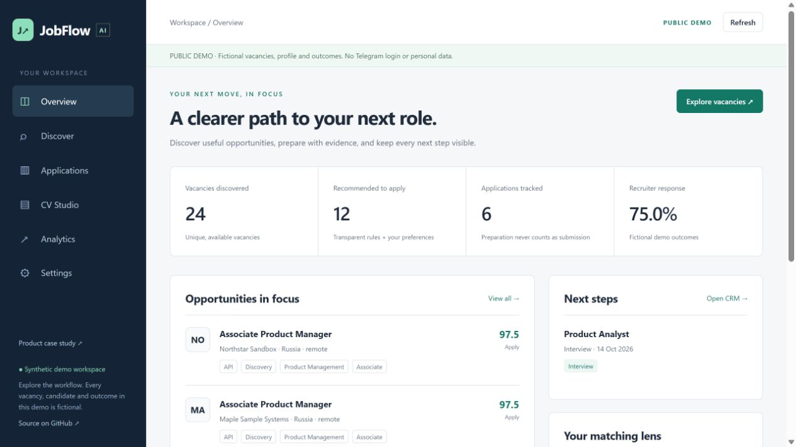
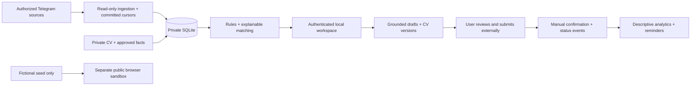

# JobFlow AI

**AI-powered job discovery, explainable CV matching, and application tracking — built around Telegram job communities.**

JobFlow turns a fragmented personal job search into one reviewable workflow: **Discover → Match → Prepare → Review → Apply → Track**. A private local app reads accessible Telegram sources, preserves vacancy evidence and CV versions, prepares factual drafts and tracks explicit application outcomes. A separate public sandbox uses fictional data only.

## Product overview and problem

Candidates repeatedly check communities, interpret inconsistent vacancy posts, compare requirements with a CV, adapt letters and remember follow-ups. The opportunity is to reduce coordination friction while retaining user judgment. Time savings and better recruiter conversion are hypotheses to measure after real use, not achieved results.

**Target users:** junior/associate/middle product, business-analysis, product-analytics and UX professionals searching UAE, Russian and international remote opportunities. Senior/Lead/Head positions are not recommended by default without confirmed fit. English and Russian posts are supported by conservative rules.

## Product assumptions and discovery

The workflow comes from Albina's intended personal search and the supplied product brief. No user interviews, adoption, recruiter response improvement or quantitative market validation are invented. See [scope and execution plan](docs/plan.md), [product decisions](docs/architecture.md) and [measurement contract](docs/metrics.md).

## My role

Albina defined the problem, target roles, geography, privacy requirements and application workflow. Development used AI engineering assistance. The implementation demonstrates requirements-to-architecture translation, external integration, structured data design, interpretable matching, human-reviewed automation and measurement design. Review and reproduce the code before presenting technical ownership in an interview.

## MVP and features

| Area | Implemented behavior | Boundary |
| --- | --- | --- |
| Telegram ingestion | Official Telethon client, bounded first history, oldest-first durable catch-up, message identity, edits/deletes, recent reconciliation and flood waits | Live operation requires the owner's authorization; event delivery is not guaranteed for every offline deletion |
| Parsing | Bilingual role/skill/location/salary extraction, vacancy/ad/roundup/news classification, original text and manual corrections | Rules do not understand every possible layout; absent fields stay null |
| Matching | Adjustable role/skill/experience/location/seniority weights, hard restrictions, evidence/gaps/unknowns and Apply/Review/Save/Skip | Design score, not hiring probability; no fabricated profile skills |
| CV Studio | PDF/DOCX import, inferred proposals, approved exact CV quotes or self-reported facts, CV versions and tailored extracts | Scanned PDFs need external OCR; a tailored extract is not a rewritten biography |
| Letters | English/Russian scaffolding, five styles, exact approved facts, editor, saved versions/copy/download | Evidence stays in its approved language; edits require renewed factual review |
| Local AI | Optional localhost Ollama constrained evidence selection with deterministic fallback | No paid API; no claimed general model quality; semantic embeddings are future work |
| Application CRM | Eleven statuses, Kanban/table, immutable status timeline, CV/letter links, dates, notes and rejection reason | Applied requires manual submission confirmation; no automatic recruiter messages |
| Analytics | Discovery/source/role/country views, explicit event funnels, response time, labels and bounded precision/recall | Unlabelled items are not negatives; small observational samples do not establish causality |
| Notifications | Opt-in personal bot digest/reminders, frequency limits and durable deduplication outbox | Separate bot credentials; ambiguous delivery is retained for inspection, not auto-retried |
| Privacy | Loopback-only app, one-time launch authentication, HttpOnly/SameSite cookie, CSRF/origin/host checks, private data isolation, backup/restore/delete | Trust the local OS account; this is not multi-user cloud hosting |

## Demo and screenshots

The [GitHub Pages sandbox](https://alyalbina.github.io/jobflow-ai/) is being deployed; its live verification status is recorded in [validation](docs/validation.md). Actual local browser captures are below. The public interface is a functional browser sandbox, not a live Telegram client. Its fictional application outcomes demonstrate UI/analytics behavior and are not product results.



[Mobile overview](docs/screenshots/overview-mobile.jpg) · [Mobile CV Studio](docs/screenshots/studio-mobile.jpg)

## Windows setup

Install Python 3.12, unpack the project and double-click **Install-Windows.cmd**, then **Start-JobFlow.cmd**. Read the [Russian step-by-step guide](docs/windows-guide.md). The launcher restricts `private/` permissions, opens a one-time local login link and starts the app on `127.0.0.1:8765`.

For Telegram, obtain your own credentials from [my.telegram.org](https://my.telegram.org) using the [official API ID instructions](https://core.telegram.org/api/obtaining_api_id). Fill `.env` locally, stop the app and run **Connect-Telegram.cmd**. Enter login codes and 2FA only in that owner-operated local console. Restart and enable sources in Settings. Never send secrets, sessions or private CVs through GitHub or chat.

Advanced setup:

```bash
python -m venv .venv
# Windows: .venv\Scripts\activate
# macOS/Linux: source .venv/bin/activate
python -m pip install --no-cache-dir pip==26.2.1 setuptools==84.0.0 wheel==0.48.0
python -m pip install --no-cache-dir --no-build-isolation -r requirements.txt
python -c "import jobflow.app, jobflow.telegram_login"
python -m jobflow.launch
```

No Telegram credentials are needed to explore the public synthetic sandbox. Basic Mode needs no LLM. Local Mode uses only your local Ollama service. JobFlow never downloads models automatically or calls a paid model API.

## Architecture and technology

Python 3.12 · FastAPI · SQLite · Telethon · asyncio scheduler · httpx · optional Ollama · pypdf/python-docx · ReportLab · buildless HTML/CSS/JavaScript · pytest · Ruff · GitHub Actions.



## Data model

`sources` and `messages` preserve source/message identity and cursors. `jobs` retain raw text, structured extraction, manual overrides and availability. `cvs` retain versions and optional parents. Profile facts have status, approval, CV ID and source excerpt. `letters` snapshot their factual evidence. `applications` link the exact CV/letter used; `status_events` record state transitions. `feedback` holds manual relevance labels. `outbox` records notification intent and delivery state. See [architecture](docs/architecture.md).

## AI matching and security

Weights start at role 25, skills 25, experience 20, location 15, seniority 10 and other preferences 5. These are product design assumptions. Unknown experience receives a neutral partial component and remains visible. Explicit mismatches are separated from missing information. Unapproved and inferred skill suggestions never become supported candidate claims.

The public build is generated from an explicit fictional seed and allowlisted assets; it never reads `private/`. Its demo adapter does not call private endpoints. `.env`, sessions, databases, real CVs and local virtual environments are ignored and excluded from distribution. The local server enforces same-origin authentication and escapes user content in the interface. See [security](docs/security.md).

## Testing

```bash
python -m pip install --no-cache-dir --no-build-isolation -r requirements-dev.txt
python -m pytest -q
python -m ruff check .
node --check web/assets/app.js
python -m scripts.build_demo
python -m scripts.check_public
python -m pip_audit -r requirements.txt
```

Executed results, hardware probe, browser QA and outstanding owner authorization are recorded in [validation](docs/validation.md). CI checks must be inspected; the presence of a workflow file alone does not prove a pass.

## Limitations and roadmap

Rule extraction can miss nonstandard titles, salary shorthand and nuanced restrictions. Exact normalized-text deduplication can conflate identical templates with different application links; compare the original source. Edit/delete reconciliation is bounded to the latest 30 known messages per source. Telegram API credentials, account access and opt-in bot delivery need owner configuration. The private interface initially loads the latest 1,000 jobs plus CRM-linked vacancies; paginated server archive search is available for older records. Multi-user access, encrypted-at-rest storage independent of the OS account, semantic embeddings and broader labelled parser evaluation are future work.

After personal activation, first validate message coverage and evidence quality, then collect a labelled bounded set and weekly search-effort logs. Prioritize fixes from observed errors before expanding acquisition sources or submission automation. See [metrics](docs/metrics.md) and [CV/LinkedIn/interview materials](docs/portfolio.md).

**License:** MIT source code. Public data is fictional demonstration material; real imported channel content remains private and subject to its source terms.
